# Concesión de préstamos personales: reglas en Visual Prolog

[](https://github.com/kenethruizbg/rcyr-prestamos/actions/workflows/compilar.yml)

Sistema basado en conocimiento que decide si se concede un préstamo personal a partir de las reglas que obtuvimos de la experta (analista de riesgos). Es la tercera entrega de **Representación del Conocimiento y Razonamiento** (Máster en IA Aplicada, UC3M, curso 2026/27): las reglas en Visual Prolog, construidas sobre la ontología de la entrega anterior.

| | |
|---|---|
| **Lenguaje** | Visual Prolog 11 (Personal Edition, build 1112) |
| **Reglas** | 20: 5 de denegación, 3 de escalado, 8 de devolución y 4 de decisión final |
| **Casos de prueba** | 18, al menos uno por regla, todos correctos |
| **Compilación** | 0 errores y 0 avisos |
| **Fichero que se entrega** | [`main.pro`](main.pro) |

## Índice

1. [Qué hace el sistema](#1-qué-hace-el-sistema)
2. [Cómo ejecutarlo](#2-cómo-ejecutarlo)
3. [Estructura del repositorio](#3-estructura-del-repositorio)
4. [De la ontología al código](#4-de-la-ontología-al-código)
5. [Cadena de razonamiento](#5-cadena-de-razonamiento)
6. [Cálculos previos](#6-cálculos-previos)
7. [Las 20 reglas](#7-las-20-reglas)
8. [Decisión final y prioridad](#8-decisión-final-y-prioridad)
9. [Casos de prueba](#9-casos-de-prueba)
10. [Capturas de la ejecución](#10-capturas-de-la-ejecución)
11. [Comprobación automática](#11-comprobación-automática)
12. [Decisiones de diseño y simplificaciones](#12-decisiones-de-diseño-y-simplificaciones)
13. [Notas sobre la implementación en Visual Prolog](#13-notas-sobre-la-implementación-en-visual-prolog)
14. [Limitaciones y posibles mejoras](#14-limitaciones-y-posibles-mejoras)
15. [Autores](#15-autores)

## 1. Qué hace el sistema

Recibe un expediente de préstamo con los datos del solicitante, de la operación, de las garantías, de la documentación aportada y de los ficheros de morosidad. Devuelve una de las cuatro decisiones que toma la experta:

| Decisión | Significado |
|---|---|
| `aprobar` | El préstamo cumple todos los criterios. |
| `denegar` | Hay un motivo que impide concederlo. |
| `devolverAOficina` | Se puede conceder si la oficina cambia algo: aportar documentación, añadir un avalista, reducir el importe o el plazo, o aclarar un impago. |
| `escalar` | Lo tiene que decidir un analista con más atribuciones. |

Cada decisión viene con su **justificación**: las reglas que la provocan y, además, las reglas que también se cumplen pero no deciden por la prioridad. En la evaluación de viabilidad vimos que la solución necesita justificación tanto para el técnico como para el cliente, y por eso el sistema la da siempre.

## 2. Cómo ejecutarlo

### En Windows, con el IDE de Visual Prolog

1. Descargar e instalar [Visual Prolog Personal Edition](https://www.visual-prolog.com/download.htm), que es gratuita para uso no comercial.
2. Abrir `rcyr.vipprj` (File › Open Project).
3. Ejecutar con Build › Execute (`F5`).
4. El programa pide un expediente:
   - Escribiendo uno (por ejemplo `EXP-003`), muestra solo ese.
   - Pulsando Enter, muestra los 18.

### Sin Windows (macOS o Linux)

Cada push compila y ejecuta el programa en un ordenador Windows de GitHub Actions ([ver ejecuciones](https://github.com/kenethruizbg/rcyr-prestamos/actions/workflows/compilar.yml)). En cada ejecución:

- El paso *Ejecutar los casos de prueba* muestra la salida completa del programa.
- El paso *Comprobar los resultados esperados* compara cada caso con lo esperado.
- El artefacto `resultados` contiene la salida, el `rcyr.exe` compilado y las capturas de pantalla.

### Desde la línea de comandos de Windows

```bat
vipBuilder.exe /build /platform x64 rcyr.vipprj
echo EXP-003| exe64\rcyr.exe
```

## 3. Estructura del repositorio

```text
.
├── main.pro                 Reglas, cálculos, casos de prueba y programa principal (lo que se entrega)
├── main.cl, main.ph         Declaración de la clase main (plantilla de consola de Visual Prolog)
├── main.pack                Paquetes que usa el programa (consola, listas y cadenas)
├── rcyr.vipprj              Proyecto de Visual Prolog
├── main.manifest, main.version, ProjectIcon.ico   Recursos de la plantilla
├── pruebas/
│   ├── esperado.txt         Decisión y reglas esperadas de cada expediente
│   ├── comprobar.ps1        Compara la salida del programa con esperado.txt
│   ├── capturas.ps1         Ejecuta cada expediente en una consola y la captura
│   ├── salida.txt           Salida real de la última ejecución
│   └── comprobacion.txt     Resultado real de la comprobación
├── docs/capturas/           Capturas de la consola de Windows, una por expediente
└── .github/workflows/compilar.yml   Compilación y pruebas en Windows
```

## 4. De la ontología al código

Cada clase de la ontología de Protégé (`ontologia_prestamos.rdf`) es una relación de hechos en `main.pro`, y cada atributo enumerado es un dominio de Visual Prolog con los mismos valores. Las propiedades de objeto se representan con identificadores compartidos: el préstamo guarda el titular que lo `solicita`, y la garantía guarda el expediente del préstamo que la `tieneGarantia`.

| Clase de la ontología | Hecho en Visual Prolog | Atributos que usan las reglas |
|---|---|---|
| `Prestatario` | `prestatario/6` | nombre, edad\*, esResidente, esClienteEntidad, cuotasDeudasActuales |
| `Prestamo` | `prestamo/7` | numeroExpediente, importe, plazo, tipoInteres, tipoPrestamo, finalidad (y el titular que lo solicita) |
| `Garantia` | `garantia/4` | tipoGarantia, valorGarantia, esPrimeraVivienda |
| `Prestamista` | `prestamista/3` | nombrePrestamista, importeMaximoAutorizado, plazoMaximoAutorizado |
| `DocumentoIdentidad` | `documentoIdentidad/3` | tipoDocumento, vigente\* |
| `CIRBE` | `cirbe/4` | deudaVivaTotal, importeDudoso, vigente\* |
| `Nomina` | `nomina/4` | salarioNetoMensual, numPagasAnuales, vigente\* |
| `IRPF` | `irpf/3` | rendimientosNetosTrabajo, vigente\* |
| `VidaLaboral` | `vidaLaboral/5` | tipoContrato, antiguedadEmpleoActual, regimenCotizacion, vigente\* |
| `FicheroNegativo` | `ficheroNegativo/4` | nombreFichero, importeImpagado, deudaSaldada |
| `FactorRiesgo` (`TasaEsfuerzo`, `LoanToValue`) | predicados `tasaEsfuerzo`, `nivelRiesgoTasa`, `loanToValue` | valor\*, nivelRiesgo\* (bajo, medio, alto) |
| `DecisionFinal` | predicado `decidir/3` | resultado, motivos, condiciones |

\* Atributo derivado en la ontología. `edad` y `vigente` se dan ya calculados, y el resto los calculan las reglas (sección 6).

Dominios (los mismos valores que en Protégé):

```prolog
tipoPrestamo = hipotecario; personalConsumo.
finalidad = compraPrimeraVivienda; compraOtraVivienda; consumoGeneral; estudios; reforma; vehiculo.
tipoGarantia = avalPersonal; hipotecaria; pignoracionSaldos.
tipoContrato = indefinido; funcionario; temporal; fijoDiscontinuo; sinContrato.
regimenCotizacion = regimenGeneral; regimenAutonomos.
tipoDocumento = dni; pasaporte; tie.
nombreFichero = asnef; experian.
nivelRiesgo = bajo; medio; alto.
resultado = aprobar; denegar; devolverAOficina; escalar.
```

Visual Prolog obliga a que los valores empiecen por minúscula. Por eso `DNI` pasa a ser `dni`, `general` pasa a ser `regimenGeneral` y `sinContrato` es un valor nuevo (ver la [sección 12](#12-decisiones-de-diseño-y-simplificaciones)).

## 5. Cadena de razonamiento

El programa sigue la misma cadena que el diagrama de conceptos: los datos del préstamo, la garantía y los ficheros negativos determinan los factores de riesgo, los factores de riesgo determinan el riesgo y el riesgo determina la decisión final.

```mermaid
flowchart LR
    subgraph H["Hechos (clases de la ontología)"]
        direction TB
        H1["Prestatario"]
        H2["Prestamo y Garantia"]
        H3["Documentacion: identidad, CIRBE, nómina, IRPF, vida laboral"]
        H4["FicheroNegativo"]
        H5["Prestamista"]
    end
    subgraph C["Cálculos previos (atributos derivados)"]
        direction TB
        C1["ingresos computables"]
        C2["cuota mensual"]
        C3["tasa de esfuerzo y su nivel de riesgo"]
        C4["loan to value"]
        C5["empleo estable, avalista, refuerzo"]
    end
    subgraph R["Reglas"]
        direction TB
        R1["D1-D5: denegar"]
        R2["V1-V8: devolver a oficina"]
        R3["E1-E3: escalar"]
    end
    H --> C --> R --> F{"F1-F4: decisión final"}
```

## 6. Cálculos previos

Son los atributos derivados de la ontología. No cuentan como reglas de decisión: las reglas los usan como condiciones.

| Predicado | Cálculo | Origen |
|---|---|---|
| `ingresosMensuales` | Con nómina: salario neto × número de pagas / 12. Si es autónomo y no tiene nómina: rendimientos del IRPF / 12. | Entrevista 1: la nómina y el IRPF dan los ingresos. Entrevista 2: el bonus no cuenta. |
| `cuotaMensual` | Sistema francés. Con *C* = importe, *i* = interés anual / 12 / 100 y *n* = plazo × 12, la cuota es *C · i / (1 − (1 + i)<sup>−n</sup>)*. | Documento de reglas |
| `tasaEsfuerzo` | (cuota nueva + cuotas de deudas actuales) / ingresos | Entrevista 2 |
| `nivelRiesgoTasa` | bajo si es menor que 0,40; medio de 0,40 a 0,60; alto si es mayor que 0,60. Es el `nivelRiesgo` borroso del factor `TasaEsfuerzo`. | Entrevista 2: menos del 40 % está bien y más del 60 % se deniega |
| `loanToValue` | importe / valor de la garantía, solo con garantía hipotecaria. El límite es 0,80 para primera vivienda y 0,70 para otra vivienda. | Entrevistas 1 y 2 |
| `empleoEstable` | Indefinido o funcionario con 2 años o más de antigüedad, o temporal o fijo discontinuo con 3 años o más | Entrevista 2 |
| `tieneAvalista` / `tieneRefuerzo` | Hay garantía de tipo aval / hay cualquier garantía (aval, hipoteca o pignoración de saldos) | Entrevista 2 |
| `tieneImpagoDeBajoPeso` | Deuda sin saldar en ASNEF o Experian, o importe dudoso en CIRBE de 1.000 € o menos | Entrevista 2 |
| `documentoFaltante` | Siempre se exigen identidad, CIRBE y vida laboral. Además, nómina en el régimen general o IRPF si es autónomo. Todos deben estar vigentes. | Entrevista 1: la documentación depende de si es autónomo |
| `plazoMaximo` | 30 años en hipotecario, 5 en vehículo y 10 en el resto de consumo | Entrevistas 1 y 2 |

## 7. Las 20 reglas

Cada regla es una cláusula de `denegacion/2`, `escalado/2` o `devolucion/2`, y su motivo lleva el código de la regla. Las cláusulas no tienen corte (`!`), así que se evalúan todas y el sistema reúne todos los motivos, no solo el primero.

### Denegar

| Regla | Condición | Origen |
|---|---|---|
| **D1** | El titular es menor de edad. | Entrevista 2: "tiene que ser mayor de edad" |
| **D2** | El titular está en desempleo. | Entrevista 2, criterios mínimos |
| **D3** | Los ingresos son menores que el SMI (16.576 €/año, 1.381,33 €/mes). | Entrevista 2, criterios mínimos (trabajo a tiempo parcial) |
| **D4** | La CIRBE tiene un importe en mora de más de 1.000 €. | Entrevista 2 |
| **D5** | La tasa de esfuerzo es mayor que 0,60 (riesgo alto). | Entrevista 2: "más de 60 % se deniega" |

### Escalar a un analista superior

| Regla | Condición | Origen |
|---|---|---|
| **E1** | El importe supera el máximo autorizado del analista (250.000 €). | Entrevista 1: cada analista tiene un límite de cuantía |
| **E2** | El plazo supera el máximo autorizado del analista (25 años). | Entrevista 1: y de plazo |
| **E3** | Préstamo de consumo de más de 8 años y hasta 10: es el tramo excepcional. | Entrevista 2: "máximo de 8 años, excepcionalmente 10" |

### Devolver a la oficina

Cada una propone a la oficina la condición que tiene que cumplir el préstamo, con los valores del atributo `condiciones` de la ontología cuando existen.

| Regla | Condición | Condición propuesta | Origen |
|---|---|---|---|
| **V1** | Falta documentación exigida o no está vigente. | aportar el documento | Entrevista 1 |
| **V2** | Hay impagos de bajo peso. | pedir aclaración al cliente | Entrevista 2: luz o agua pueden ser un conflicto comercial |
| **V3** | Edad + plazo es 80 o más y no hay avalista ni garantía. | `exigirAvalista` o `pignorarSaldos` | Entrevista 2 |
| **V4** | No tiene empleo estable y no hay avalista. | `exigirAvalista` | Entrevista 2: "si menos [de 2 años], se piden avalistas" |
| **V5** | La tasa de esfuerzo está entre 0,40 y 0,60 (riesgo medio) y no hay avalista. | `exigirAvalista` | Entrevista 1: se pide un avalista con más capacidad de reembolso |
| **V6** | No es residente y no hay avalista ni garantía. | `exigirAvalista` o `pignorarSaldos` | Entrevista 2: no residentes, más restricciones |
| **V7** | El plazo supera el máximo para su tipo y finalidad. | reducir el plazo | Entrevistas 1 y 2: el plazo debe ir con la finalidad |
| **V8** | El LTV supera el límite. | `reducirImporte` | Entrevistas 1 y 2: 80 % o 70 % |

## 8. Decisión final y prioridad

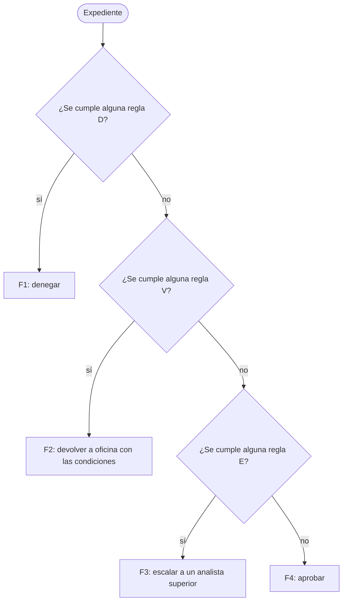

Por qué este orden:

- **Denegar va primero.** Si hay un motivo de denegación, cualquier otra cosa sobra: cambiar condiciones o escalar no lo arreglan.
- **Devolver va antes que escalar.** No tiene sentido que un analista superior estudie un expediente incompleto o que todavía necesita cambios. Primero la oficina lo corrige y después, si sigue superando el límite, se escala. La experta lo explicó así: devolver con cambios está mejor visto que denegar, porque denegar penaliza a la oficina.
- **Aprobar solo si no se cumple ninguna regla.**

Las reglas que se cumplen pero no deciden no se pierden. El informe las enseña aparte, en "También se cumplen". Por ejemplo, en EXP-003 la decisión es devolver por V4 y V8, pero el informe avisa de que, cuando se corrija, el plazo de 30 años obligará a escalar (E2).

## 9. Casos de prueba

Hay 18 expedientes. Cada una de las 20 reglas es la que decide en al menos uno.

| Exp. | Titular | Situación | Cuota | Tasa | Decisión | Reglas que deciden | También se cumplen |
|---|---|---|---:|---:|---|---|---|
| 001 | Ana, 35 | Consumo de 15.000 € a 5 años, todo en orden | 297,02 | 0,12 | aprobar | F4 | |
| 002 | Luis, 41 | 3.500 € en mora en CIRBE y un recibo en ASNEF | 292,96 | 0,24 | denegar | D4 | V2 |
| 003 | Marta, 52 | Hipoteca 200.000 € / 30 años, LTV 0,87, temporal 1,5 años | 843,21 | 0,33 | devolver | V4, V8 | E2 |
| 004 | Pedro, 38 | Consumo a 9 años | 360,17 | 0,13 | escalar | E3 | |
| 005 | Hugo, 17 | Menor de edad | 190,80 | 0,11 | denegar | D1 | V4 |
| 006 | Elena, 45 | En desempleo | 195,30 | | denegar | D2 | V1 |
| 007 | Jorge, 29 | Media jornada, 1.050 €/mes | 119,73 | 0,11 | denegar | D3 | |
| 008 | Sara, 33 | Ya paga 900 €/mes de otras deudas | 495,03 | 0,66 | denegar | D5 | |
| 009 | Raúl, 47 | Autónomo (IRPF), CIRBE caducada | 302,58 | 0,10 | devolver | V1 | |
| 010 | Lucía, 31 | Recibo de 300 € sin pagar en Experian | 217,61 | 0,09 | devolver | V2 | |
| 011 | Antonio, 72 | 72 + 8 años de plazo, sin garantía | 197,12 | 0,07 | devolver | V3 | |
| 012 | Carmen, 39 | Tasa de esfuerzo 0,45, sin avalista | 340,98 | 0,45 | devolver | V5 | |
| 013 | Olivier, 36 | No residente, sin garantía | 239,46 | 0,09 | devolver | V6 | |
| 014 | Iván, 27 | Coche a 7 años (máximo 5) | 321,39 | 0,13 | devolver | V7 | |
| 015 | Beatriz, 44 | Hipoteca de 300.000 € (máximo 250.000) | 1.422,63 | 0,20 | escalar | E1 | |
| 016 | Daniel, 34 | Hipoteca a 28 años (máximo 25) | 811,75 | 0,30 | escalar | E2 | |
| 017 | Rosa, 76 | 76 + 5 años, pero con pignoración de saldos | 193,33 | 0,09 | aprobar | F4 | |
| 018 | Marcos, 26 | Contrato temporal de 1 año, pero con avalista | 169,25 | 0,09 | aprobar | F4 | |

Cobertura de reglas:

| Regla | D1 | D2 | D3 | D4 | D5 | E1 | E2 | E3 | V1 | V2 | V3 | V4 | V5 | V6 | V7 | V8 | F1 | F2 | F3 | F4 |
|---|---|---|---|---|---|---|---|---|---|---|---|---|---|---|---|---|---|---|---|---|
| Decide en | 005 | 006 | 007 | 002 | 008 | 015 | 016 | 004 | 009 | 010 | 011 | 003 | 012 | 013 | 014 | 003 | 002, 005–008 | 003, 009–014 | 004, 015, 016 | 001, 017, 018 |

Algunos casos están pensados para comprobar matices del razonamiento:

- **Prioridad:**
  - En 002, D4 se impone a V2.
  - En 005, D1 se impone a V4.
  - En 003, V4 y V8 se imponen a E2.
- **Refuerzos:**
  - En 017, la pignoración de saldos evita V3 aunque edad + plazo sea 81.
  - En 018, el avalista evita V4 aunque el contrato sea temporal.
  - En 003, la hipoteca evita V3 aunque edad + plazo sea 82.
- **Fronteras:**
  - En 011, edad + plazo es exactamente 80, y la regla salta porque el límite incluye el 80.
  - En 015, el LTV de 0,67 está por debajo del límite de 0,70 de la segunda vivienda.
  - En 004, el plazo de 9 años no salta en V7 (el máximo de consumo es 10), pero sí en E3.

La salida completa está en [`pruebas/salida.txt`](pruebas/salida.txt).

## 10. Capturas de la ejecución

Son capturas reales de la consola de Windows con el programa compilado. Se hacen en cada ejecución de GitHub Actions con [`pruebas/capturas.ps1`](pruebas/capturas.ps1).

**EXP-001: aprobar.** Todo en orden.


**EXP-002: denegar por D4.** También se cumple V2, pero la denegación tiene prioridad.

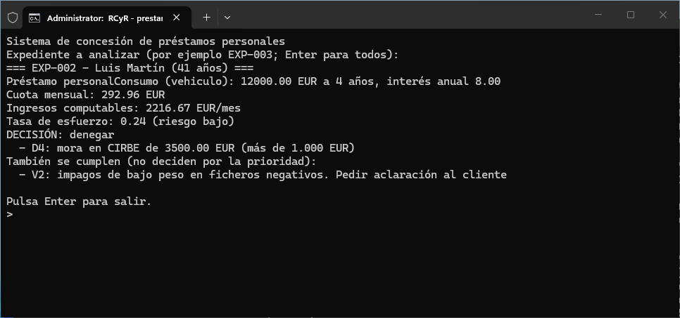

**EXP-003: devolver por V4 y V8.** También se cumple E2.

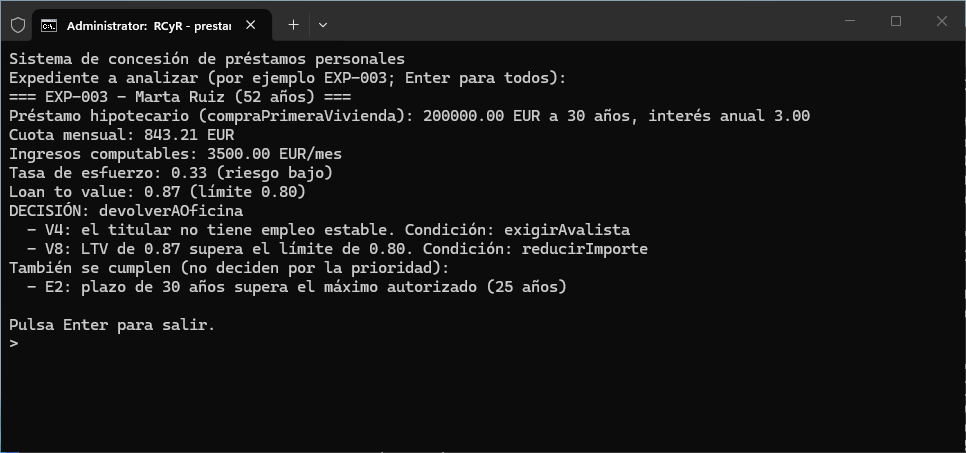

**EXP-004: escalar por E3.**

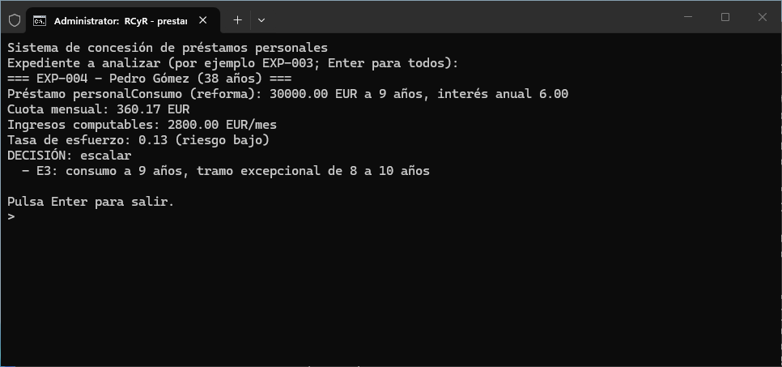

<details>
<summary><b>Resto de expedientes (005 a 018) y expediente inexistente</b></summary>

**EXP-005: denegar por D1** (menor de edad)

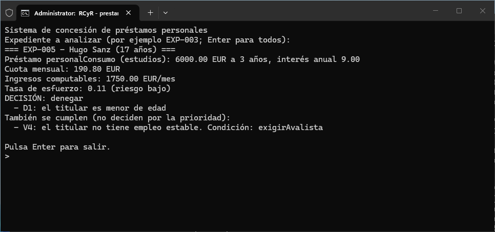

**EXP-006: denegar por D2** (desempleo)

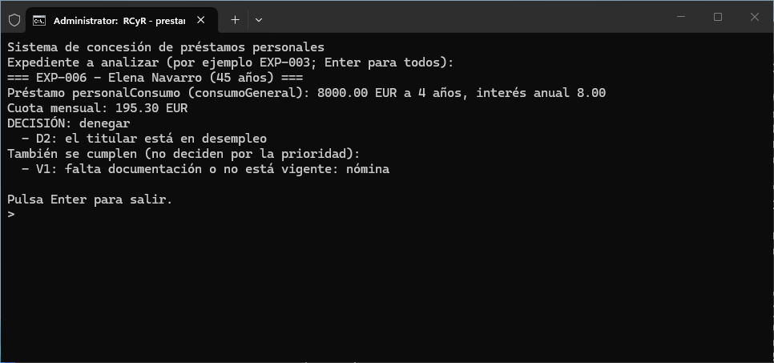

**EXP-007: denegar por D3** (ingresos por debajo del SMI)

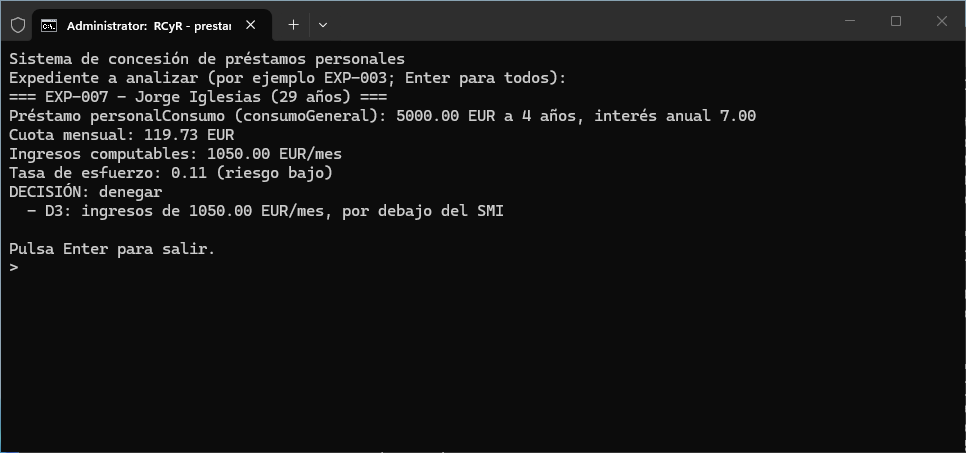

**EXP-008: denegar por D5** (tasa de esfuerzo alta)

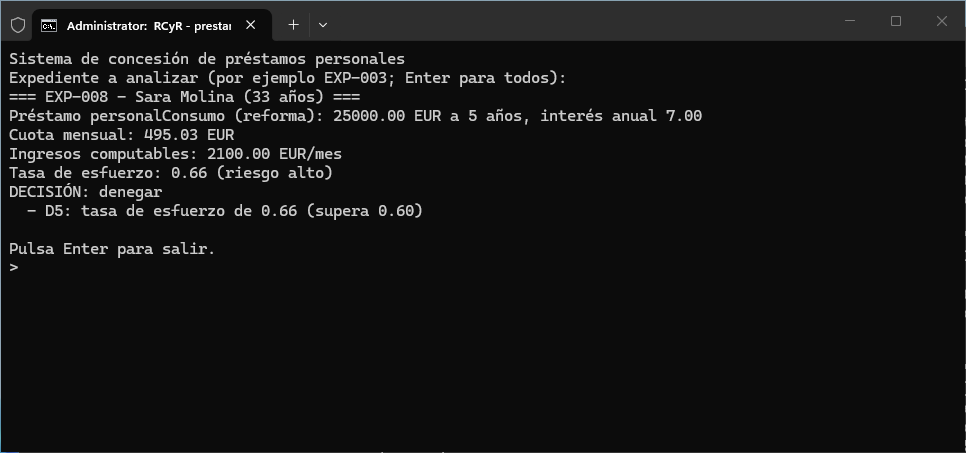

**EXP-009: devolver por V1** (CIRBE caducada)

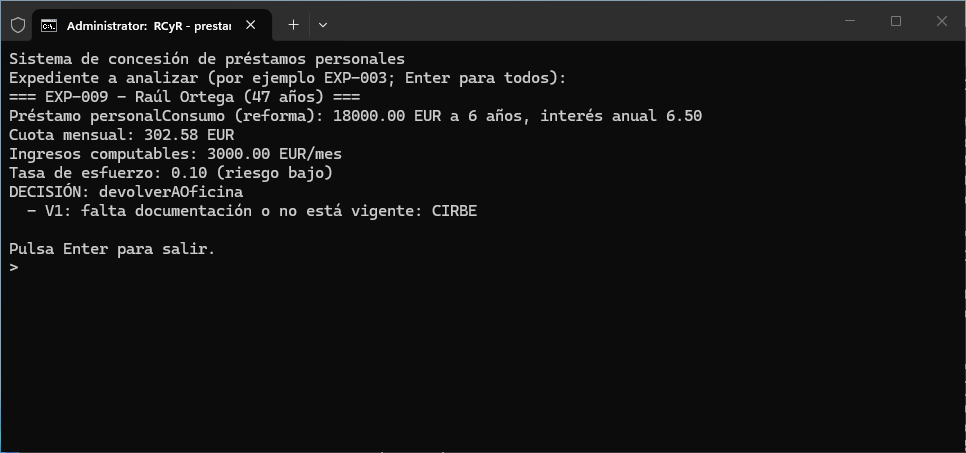

**EXP-010: devolver por V2** (impago en Experian)

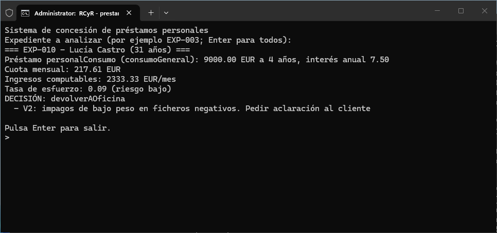

**EXP-011: devolver por V3** (edad + plazo)


**EXP-012: devolver por V5** (tasa de esfuerzo media)

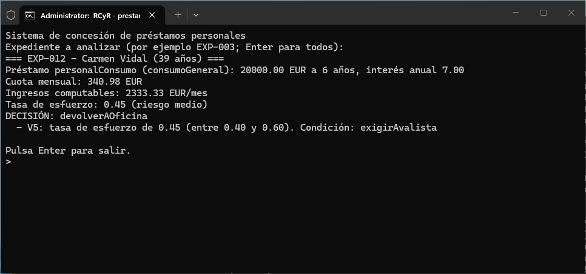

**EXP-013: devolver por V6** (no residente)


**EXP-014: devolver por V7** (plazo excesivo para un vehículo)

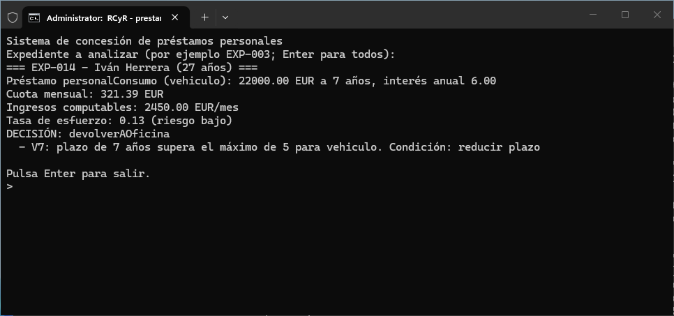

**EXP-015: escalar por E1** (importe)

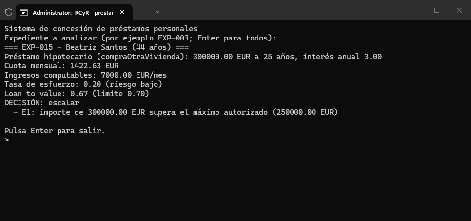

**EXP-016: escalar por E2** (plazo)

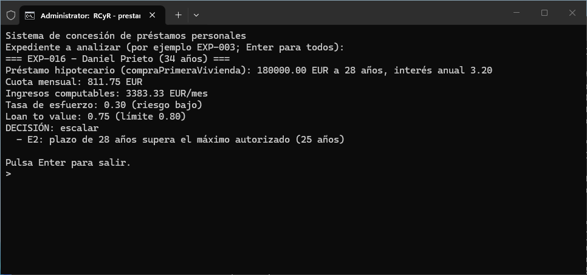

**EXP-017: aprobar** (la pignoración de saldos cubre la edad)


**EXP-018: aprobar** (el avalista cubre el contrato temporal)

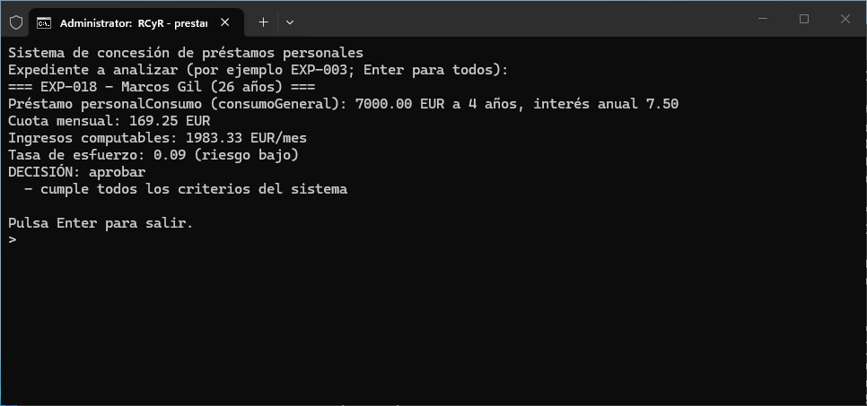

**Expediente que no existe**

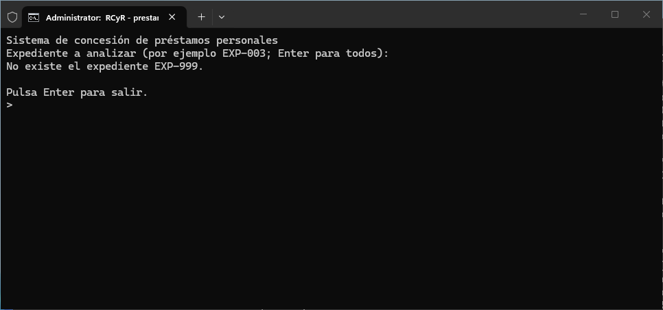

</details>

## 11. Comprobación automática

[`pruebas/esperado.txt`](pruebas/esperado.txt) recoge la decisión y las reglas que deben salir en cada expediente. El script [`pruebas/comprobar.ps1`](pruebas/comprobar.ps1) lee la salida del programa y la compara caso por caso. Si alguno no coincide, el workflow falla. Este es el resultado de la última ejecución:

```text
Exp.     Esperado          Reglas     Obtenido          Reglas     OK
EXP-001  aprobar           F4         aprobar           F4         sí
EXP-002  denegar           D4         denegar           D4         sí
EXP-003  devolverAOficina  V4 V8      devolverAOficina  V4 V8      sí
EXP-004  escalar           E3         escalar           E3         sí
EXP-005  denegar           D1         denegar           D1         sí
EXP-006  denegar           D2         denegar           D2         sí
EXP-007  denegar           D3         denegar           D3         sí
EXP-008  denegar           D5         denegar           D5         sí
EXP-009  devolverAOficina  V1         devolverAOficina  V1         sí
EXP-010  devolverAOficina  V2         devolverAOficina  V2         sí
EXP-011  devolverAOficina  V3         devolverAOficina  V3         sí
EXP-012  devolverAOficina  V5         devolverAOficina  V5         sí
EXP-013  devolverAOficina  V6         devolverAOficina  V6         sí
EXP-014  devolverAOficina  V7         devolverAOficina  V7         sí
EXP-015  escalar           E1         escalar           E1         sí
EXP-016  escalar           E2         escalar           E2         sí
EXP-017  aprobar           F4         aprobar           F4         sí
EXP-018  aprobar           F4         aprobar           F4         sí

Casos correctos: 18 de 18
```

Antes de escribir los hechos simulamos los cálculos (cuota, tasa de esfuerzo y LTV) para fijar los valores esperados. El programa da los mismos valores al céntimo.

## 12. Decisiones de diseño y simplificaciones

El documento de reglas inicial tenía 23 reglas de decisión, y algunas usaban datos que no están en la ontología. Para quedarnos en 20 y que todo lo que usan las reglas esté en la ontología, tomamos estas decisiones:

| Decisión | Motivo |
|---|---|
| Un solo titular por préstamo | La ontología no tiene cotitulares. Las reglas de "todos los titulares" se aplican al titular, y la de "solo algunos titulares tienen impagos" (E6) desaparece. |
| Se quitan fallido, riesgo reputacional, riesgo país, sector sensible, garantía fuera de España y "hipotecario sin precio de compra" | No hay atributos en la ontología para representarlos. |
| No se tienen en cuenta el alquiler, la pensión alimentaria ni el bonus | Tampoco están en la ontología. La tasa de esfuerzo usa la cuota nueva y las cuotas de las deudas actuales. |
| El avalista es una `Garantia` de tipo `avalPersonal`, y se da por bueno | La ontología no tiene una clase avalista. Comprobar que el avalista cumple lo mismo que el titular necesitaría modelarlo como otro `Prestatario`. |
| `tipoContrato` lleva el valor `sinContrato` | Hacía falta para representar el desempleo (D2). |
| El tope de devolución en consumo es 10 años, y de 8 a 10 se escala | En el documento inicial había un conflicto: "máximo 8 años" devolvía y "de 8 a 10 se escala" escalaba. Como devolver va antes que escalar, la segunda regla no saltaba nunca. |
| El analista de nivel 1 tiene un límite de 250.000 € y 25 años | Son valores de ejemplo. Con 30 años la regla E2 no saltaba nunca, porque el plazo máximo de una hipoteca (V7) ya es 30. |
| No está la finalidad "gastos puntuales" (3 años) | No es un valor del enumerado `finalidad` de la ontología. |
| `edad` y `vigente` se dan ya calculados | En la ontología se derivan de `fechaNacimiento` y `fechaEmision`. Calcularlos exige la fecha del sistema y no aporta nada a las reglas. |
| Los pensionistas se representan con una nómina y un contrato indefinido | El documento de reglas dice que un jubilado cuenta como empleo estable, y la ontología no tiene un tipo pensión. |

## 13. Notas sobre la implementación en Visual Prolog

- **Tipado estricto.** Cada predicado declara el tipo de sus argumentos, su modo (`determ`, `nondeterm` o `procedure`) y qué argumentos son de salida (`[out]`). El compilador comprueba que una regla `determ` no pueda dar dos soluciones y que un `procedure` no pueda fallar.
- **Hechos agrupados.** Visual Prolog exige que las cláusulas de un mismo predicado vayan seguidas (error c248). Por eso los casos de prueba están ordenados por relación y no por expediente; el comentario de la sección 5 de `main.pro` los describe caso a caso.
- **Reglas sin corte.** Las reglas D, E y V son cláusulas de predicados `nondeterm` sin `!`. Así, la comprensión de listas `[ Motivo || denegacion(Expediente, Motivo) ]` recoge todas las que se cumplen, y la justificación sale completa.
- **Decisión final con corte.** Las cuatro cláusulas de `decidir/3` sí llevan corte: la primera categoría con motivos decide y las demás ya no se prueban. Es la manera de expresar la prioridad.
- **Funciones.** `nivelRiesgoTasa`, `limiteLTV` y `plazoMaximo` son predicados que devuelven un valor (`-> nivelRiesgo`). Así se leen como en las tablas de la experta.
- **Paquetes.** El programa usa las clases `string` y `list` de la PFC. Sus `#include` van al principio de `main.pro` y no en `main.pack`, para que `main.pro` compile solo dentro de cualquier proyecto de consola nuevo.

## 14. Limitaciones y posibles mejoras

- Los datos de los expedientes están escritos como hechos en el código. Una versión de uso real los leería de un fichero o de un formulario y los cargaría con `assert`.
- El nivel de riesgo de la tasa de esfuerzo es borroso solo de nombre: los cortes en 0,40 y 0,60 son nítidos. Con funciones de pertenencia, un caso de 0,59 y otro de 0,41 no tendrían el mismo peso.
- Solo se calcula el nivel de riesgo de `TasaEsfuerzo`. `Morosidad`, `CapacidadReembolso` y el `Riesgo` global de la ontología se podrían calcular igual y combinar.
- Para volver a meter las reglas que quitamos (cotitulares, avalista validado como un titular, riesgo reputacional y riesgo país) haría falta ampliar la ontología.

## 15. Autores

- Fabián Alejandro Gutiérrez Peña (568480)
- Sergio Mínguez Cruces (602888)
- Keneth Guillermo Ruiz Martínez (601403)
